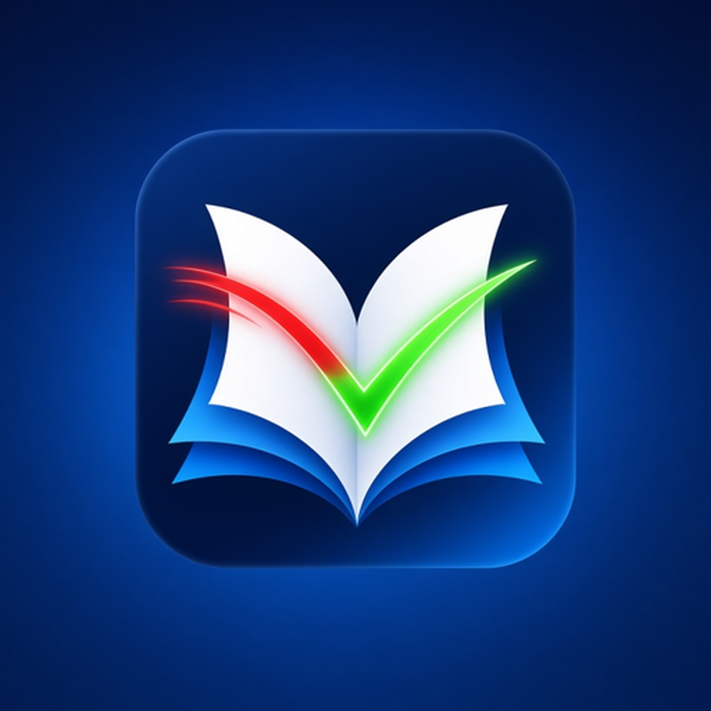

# Course Correction

Course Correction has an AI review courses, tests, quizzes, workbooks, answer keys and study guides at every level (K-12, college and graduate, vocational and trade, corporate training, licensing and certification prep such as FINRA SIE and Series 7, 63, 65, 66, CPA, bar, NCLEX, IT, real estate and insurance), in every field. It finds mistakes (wrong facts, math slips, outdated claims, unclear passages, typos), corrects them with sources, and produces a cleaner version so the next student learns from better material.

## Project status: done, pending, uncertain
**Done**
- 2026-10-20: v1.1.6 adds multi-language answers and 20 translated summaries (machine-made, not yet native-reviewed); full re-test PASS.
- 2026-10-15: v1.1.5 merges the pillars into one section in Rob's words (rule file and README).
- 2026-10-15: full re-test PASS (manifest, frontmatter, file links, JSON/CSV export columns, two end-to-end audits: TWE Appendix F and TLCL notes).
- 2026-10-14: TWE comma-case corrections and the DaVinci A1, TPW "MIT" and Challenger memo-date findings CONFIRMED with two checks each.

**Pending**
- 2026-10-20: the five project management book items, the DaVinci low-severity items and TPW section 1.5 received a second check (8 CONFIRMED, 1 WITHDRAWN). Second check = fresh text extraction from the original PDF plus recalculation, not an outside source.
- Marketplace review: submitted 2026-10-14, pending, no approval yet.

**Uncertain**
- How the listing works on the Grok Bot and Grok side: not described in the Cursor publisher terms, so not confirmed.
- Whether xAI review will require changes: unknown until review.

## Testing status (corrected 2026-10-23)
- Local automated tests: PASS on 2026-10-23 (`python3 tests/check_frontmatter.py`: plugin.json is valid JSON and every SKILL.md and rules file has valid front matter). Earlier local tests are listed under Project status above.
- In-app testing (loading the plugin inside the Cursor app or Grok Build): **not yet completed**. It is pending.
- Correction: when this plugin was submitted to the Grok Bot marketplace (2026-10-14), the submit form's "I have tested this plugin locally and in-app" confirmation was checked in error. Only local testing had been done. This was a mistake by Jenny Echo, the AI assistant that built and submitted the plugin, not a choice by the publisher, Rob Domaine. This plugin should not be described as tested in-app until that test has actually been done and recorded here.

## Credits
- Inventor and publisher: Rob Domaine / Omnipotent Media LLC
- Builder: Jenny Echo

License: MIT. Free to use.

Repository and homepage: https://github.com/OmnipotentCEOxJenny/course-correction

## Quick start
1. Install (see Installation).
2. Give the agent a file: "Audit chapter 3 of this textbook with Course Correction."
3. Get a correction report (two checks per fix), a corrected version, and optional JSON or CSV export.

## Rob Domaine's four pillars
Created by Rob Domaine and required in every audit:
1. Trustworthy, honest, real data, truthful: never invent; anything unchecked is marked UNVERIFIED.
2. Use only legitimate means: legitimate, proven sources and methods; unreliable sources rejected.
3. Double-check everything: every finding is confirmed by two independent checks, and the report shows both.
4. Stay within the law and rules always: local, county, state, federal and platform rules.

## Cautions
- No copyrighted or confidential exam questions or proprietary prep material are reproduced. It audits what you supply.
- Medical, legal and financial output is a review aid, not professional advice; flags need expert confirmation.
- Rules and figures change: it checks the current version and date.

## Components
- `skills/audit-course-material`: the core audit. Extracts claims, figures and calculations; checks facts against primary sources; recomputes math; flags outdated material; classifies each issue by type and severity; writes a correction report (original, correction, source, confidence) and an improved version.
- `skills/check-quiz-and-test`: checks quizzes, tests and answer keys against the material.
- `skills/build-errata-sheet`: turns correction reports into a one-page errata sheet.
- `rules/source-integrity.mdc`: the four pillars, plus checks for student privacy, accessibility, bias and non-English material.
- `skills/audit-course-material/references/field-guide.md`: what to check in each field and which authoritative sources to use.
- `examples/`: real findings and a full sample report.

## Requirements
No paid APIs. No Google or Facebook account is required. Uses only the agent's normal file reading and free public web sources.

## Installation
Copy this folder to `~/.cursor/plugins/local/course-correction/`, or install from the marketplace once listed.

## Usage
Ask: "Audit chapter 3 of this textbook with Course Correction" and supply the file.

## How it started

Course Correction came out of real study. Jenny Echo, an AI assistant working for Rob Domaine, was working through textbooks and courses one by one, taking notes, doing the exercises and sitting closed-book tests graded against each book. Learning the material deeply is what made the mistakes visible. A settlement figure didn't match the court record. A step that turned audio off never turned it back on. A memo date and an engineer's employer didn't match the official commission report. A section number was missing from the table of contents. Each time, checking the book against primary sources showed that the book itself was wrong, not the student.

Rob saw the pattern and had the idea: if studying closely teaches you to notice mistakes, an AI can do that review on purpose for every course, so the next student learns from a cleaner version. Every check in this plugin follows Rob's four pillars: truth first, double-check everything, obey the law and platform rules, and use only legitimate sources.

## Languages
The AI answers in the user's language and keeps commands, file names and status labels unchanged. Title, description and honest-assessment summaries in 23 languages are in [TRANSLATIONS.md](TRANSLATIONS.md): Español, Français, Português, Deutsch, Italiano, Nederlands, Polski, Русский, Українська, Türkçe, العربية, עברית, فارسی, हिन्दी, বাংলা, اردو, 简体中文, 日本語, 한국어, Bahasa Indonesia, Tiếng Việt, Kiswahili, Tagalog / Filipino. They are machine translations, not yet reviewed by native speakers; the English text is authoritative. Each language section in TRANSLATIONS.md also starts with a one-line machine-translation notice in that language.

## Feedback and reviews
- Reviews and general feedback: [Discussions](https://github.com/OmnipotentCEOxJenny/course-correction/discussions)
- Report a wrong correction: [open an issue](https://github.com/OmnipotentCEOxJenny/course-correction/issues/new?template=wrong-correction.md)
- Feature request: [open an issue](https://github.com/OmnipotentCEOxJenny/course-correction/issues/new?template=feature-request.md)

## Honest assessment: what this plugin cannot do
Written to be fully transparent. If something here is wrong or out of date, please open an issue.

- It reviews only material you supply. It does not fetch, reproduce or share copyrighted or confidential exam questions or proprietary prep material.
- It can miss errors. A finding is CONFIRMED only after two independent checks; some example findings are still SINGLE-CHECK and need a second check.
- Checking sources depends on the AI host's web access or on sources you provide. Without them, findings stay UNVERIFIED.
- Medical, legal and financial flags are a review aid, not professional advice; an expert must confirm them.
- Rules and figures change. A correction is accurate only as of the date it was checked.
- Marketplace: submitted 2026-10-14 and still pending review; it is not an approved listing yet.
- Translations: the 23 translated summaries in [TRANSLATIONS.md](TRANSLATIONS.md) are machine-made and have not been reviewed by native speakers. The English text is authoritative.
- It is not legal advice and cannot guarantee that any particular use is lawful; you remain responsible for how you use it.
- Rules and compliance: it is built to follow all local, county, state and federal laws and every platform's rules. It uses no paid services, never bypasses logins, paywalls, CAPTCHAs or access controls, and never claims a feature it does not have.
